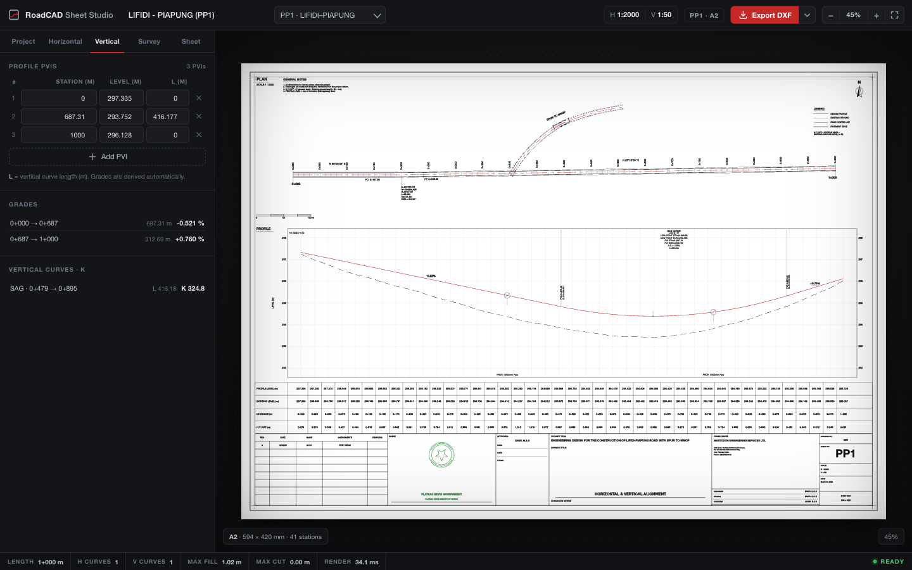
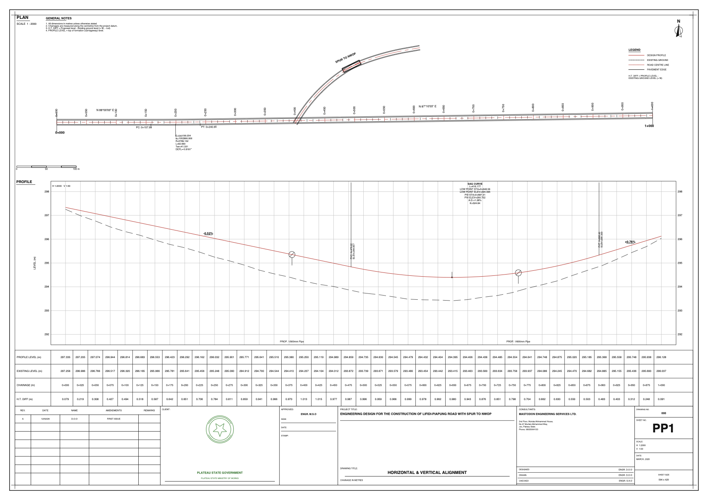

# RoadCAD Sheet Studio

Parametric generator for highway **horizontal & vertical alignment sheets** — the
"PLAN + PROFILE + LEVELS + TITLE BLOCK" drawing that Nigerian consulting firms
(LIFIDI-PIAPUNG / PP1 / PP3 style) submit for road construction.

It computes the alignment from survey data (PI coordinates, radii, PVI levels and
existing ground), lays out an A-series sheet, and exports:

| Format | Use |
| ------ | --- |
| **DXF (AutoCAD R12, mm)** | open/plot/edit in AutoCAD, Civil 3D, BricsCAD, LibreCAD, QCAD |
| **PDF (A1/A2/A3)** | print, archive, send on WhatsApp |
| **SVG** | web preview, Illustrator/Inkscape |
| **CSV** | levels & cut/fill to Excel / QGIS / 12d |

No dependencies, no build step, no cloud account required.






## Quick start

```bash
npm run dev          # app at http://127.0.0.1:4321
npm run build:all    # out/LIFIDI-PP1.{dxf,pdf,svg,csv} + PP3
npm run verify       # geometry/drawing QA + 41 unit tests
```

Open the app, edit the PI / PVI tables or paste survey levels, and the sheet
re-renders live. **Export DXF** downloads the drawing AutoCAD opens natively.

## What is generated

```
+------------------------------------------------------------------+
| PLAN      centreline + carriageway/shoulder edges, 10 m ticks,    |
|           50 m station labels, PC/PT callouts, curve data blocks  |
|           (E, N, R, L, Tan, Δ), bearings, side road, north arrow, |
|           scale bar, legend, general notes                        |
+------------------------------------------------------------------+
| PROFILE   level grid (both axes), design profile (red), existing  |
|           ground (dashed), grade %, PVC/PVT tags, vertical curve   |
|           callouts (L, HIGH/LOW POINT, PVI, A.D., K), culverts     |
+------------------------------------------------------------------+
| LEVELS    PROFILE LEVEL / EXISTING LEVEL / CHAINAGE / H.T. DIFF    |
+------------------------------------------------------------------+
| REVISION  | CLIENT SEAL | TITLE | CONSULTANTS | SHEET NO / SCALE   |
+------------------------------------------------------------------+
```

Every value is computed, not typed in: change a radius and the tangent length,
curve length, PC/PT stations, plan geometry, table and title block scale all
update together.

## Engineering model

**Horizontal** — PI polyline in Easting/Northing with a circular curve radius at
each interior PI:

* `T = R·tan(Δ/2)`, `L = R·Δ`, `E = R(1/cos(Δ/2) − 1)`, `M = R(1 − cos(Δ/2))`
* plan geometry is sampled from the tangent/arc element chain, so stations,
  offsets and curve data can never drift apart
* deflections are measured as the signed change in azimuth (+ clockwise/right)

**Vertical** — PVIs `{station, level, L}` with parabolic vertical curves:

* `g = Δlevel/Δstation·100`, `A = g₂ − g₁`, `K = L/|A|`
* `y(t) = y_PVC + g₁t/100 + A·t²/(200L)` inside the curve
* high/low point at `t = −g₁L/A` (reported in the callout, as on the reference
  sheet)

**H.T. DIFF** = proposed level − existing ground level: `+` fill, `−` cut.
Existing ground is linearly interpolated between survey picks.

Verified against the reference: curve `R = 5789.132`, `L = 82.649`, `T = 41.325`,
`sag L = 416.177`, `LOW POINT 0+648.56 @ 294.395`, `K = 324.84` — matching the
LIFIDI sheet.

## What a tweak changes

Every drawn value is derived, so editing one number moves everything that depends
on it (the app re-renders in ~20-40 ms, exports always match the preview):

| Edit | Ripples into |
| --- | --- |
| PI easting/northing | alignment length, bearings, plan rotation, chainages, station count, H scale, table |
| PI radius | tangent `T`, curve `L`, `PC`/`PT` stations, plan geometry, curve data block — profile unchanged |
| PVI level | grades, `A`, `K`, high/low point and its elevation, profile shape, V scale/level axis, levels table, H.T. DIFF |
| PVI station | grades either side, curve limits, callout stations, table sampling |
| survey level | existing-ground line, H.T. DIFF cells, fill/cut stats, V scale range |
| station interval | table columns, profile vertical grid, number of entities (font auto-fits) |
| sheet size / `auto` scale | H and V scale denominators, margins, sheet label |

Not derived (edit as text): title-block fields, sheet number/date, general notes,
revision log, structure labels. If the numbers contradict each other (radius too
large for the PI spacing, overlapping vertical curves, a PVI outside the
chainage) the app shows a validation error and keeps the last good sheet instead
of drawing something wrong.

## Using the DXF in AutoCAD

1. `npm run build` → `out/LIFIDI-PP1.dxf`.
2. In AutoCAD: `OPEN` the DXF (R12, drawing units = millimetres).
3. The sheet is drawn 1:1 in model space on an A2 page; set `INSUNITS = 4`.
4. Layers are already separated and coloured: `PLAN_EDGE`, `PLAN_CL`,
   `PROF_DESIGN` (red), `PROF_GROUND` (dashed), `PROF_GRID`, `TABLE_*`,
   `TITLE_*`, `FRAME`.
5. To plot: `PLOT` → `DWG To PDF.pc3` → ISO A2 (594 × 420 mm) → Plot area
   *Extents* → Plot scale **1:1** → Plot style `monochrome.ctb`.
6. Edit anything you like (move the title block, change text styles, add notes),
   then `SAVEAS` DWG.

`TextSTYLE = STANDARD` uses `arial.ttf`; replace it with `ISOCPEUR` / `isocp.shx`
if your office standard needs the ISO CAD look.

## Autodesk cloud path (optional)

The local DXF route needs no Autodesk account. If you want the sheet produced by
**AutoCAD itself in the cloud** (AutoCAD Automation / Design Automation), the
pipeline is:

1. OAuth token: `POST https://developer.api.autodesk.com/authentication/v2/token`
   (`client_credentials`, scope `code:all data:write data:read bucket:create bucket:read`).
2. Create a bucket + upload the DXF or an input DWG
   (`POST /oss/v2/buckets`, then the signed-S3 `PUT` from
   `GET /oss/v2/buckets/{bucket}/objects/{object}/signeds3upload`).
3. Submit a work item: `POST https://developer.api.autodesk.com/da/us-east/v3/workitems`
   with an Activity that runs `accoreconsole.exe /i input.dxf /s script.scr`
   (the `.scr` runs `-PLOT`/`EXPORT`/`SAVEAS` to make the DWG).
4. Poll the work item, download the signed output URL.

That is the correct architecture, but it needs an APS app, a paid
Design Automation entitlement, an app bundle with `accoreconsole`, and a
published Activity — so this repo ships the DXF instead of pretending to have it.
[APS Design Automation docs](https://aps.autodesk.com/developer/overview/automation-api).

## Repo map

```
src/core/      alignment & profile maths, project model, formatting
src/draw/      entity model, layers, layout, plan, profile, table, title block
src/export/    DXF writer, SVG renderer, PDF writer, CSV
index.html     the studio app (vanilla ES modules)
presets/       LIFIDI PP1 / PP3 demo projects (data only)
tools/         dev server, CLI builder, preset generator, QA validator
tests/         41 node:test specs (maths, sheet, DXF, SVG/PDF)
docs/          contract + CAD workflow notes
out/           generated sheets (not committed)
ref/           reference screenshots (not committed)
```

## Verification

* `npm run check` — finite geometry, inside-sheet, non-overlapping bands,
  table numbers centred on their stations and fitting their cells, monotone
  profile, DXF section/pair/EOF structure, no NaN.
* `npm test` — 41 specs incl. exact reference curve numbers, A1/A3 adaptation,
  DXF determinism and ASCII safety, PDF page size and AFM centring.
* DXF audited by **ezdxf** (independent implementation): `readfile OK`,
  `audit: 0 errors, 0 fixes`, all 27 layers resolve.
* PDF is a real vector A2 page; rasterised for visual comparison against the
  reference sheets.

## Limitations

* Circular curves only (no clothoids/transitions), no superelevation, no
  cross-sections, no earthwork volumes, no corridor model.
* One sheet per alignment; alignments longer than ~2 km need a larger sheet or
  a smaller scale (the scale auto-fits, the table interval auto-thins).
* Junction geometry is a trimmed side road, not a filleted kerb return.
* Chainage runs from 0 at the first PI node (`startStation` is configurable).
